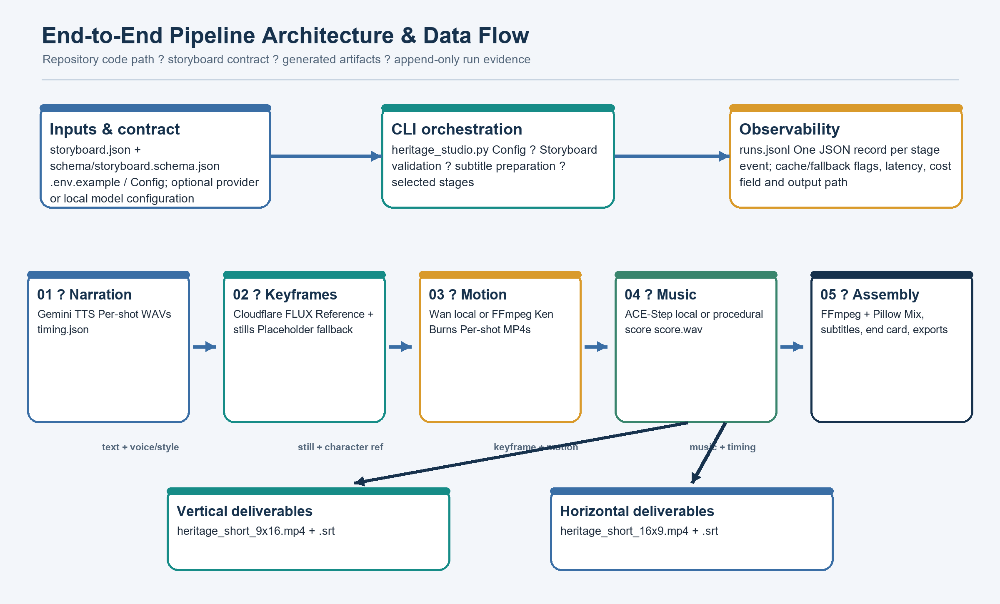
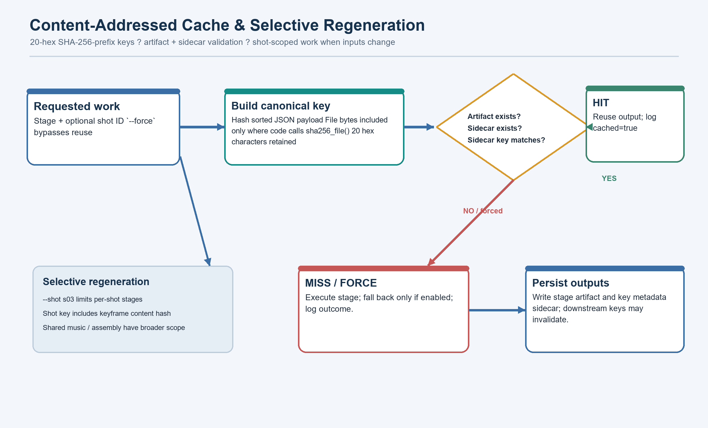
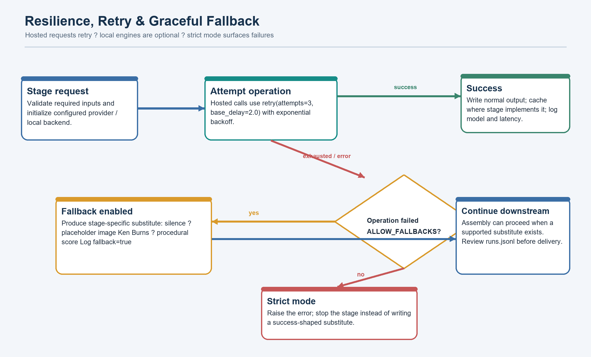

# Heritage Short Studio — Engineering Submission Report

## Submission metadata

| Field | Repository-grounded value |
|---|---|
| Author | Not identified in the inspected repository. |
| Date | 2026-11-26 |
| Repository URL | Not recorded. The inspected workspace has no Git repository metadata or configured remote. |
| Deliverables | [Markdown report](REPORT.md); [formatted Word report](REPORT_with_diagrams.docx); [architecture diagram](report_assets/architecture.png); [cache-flow diagram](report_assets/cache_flow.png); [resilience diagram](report_assets/resilience.png). |
| One-command reproduction | `python heritage_studio.py run --story storyboard.json --aspect both` |
| Test status | `python -m pytest -q`: **8 passed**. `python heritage_studio.py validate`: **passed**, 9 shots / 64.0 s declared shot duration. |

The reproduction command is the CLI command documented in `README.md`. Provider credentials and optional local model installations are environment-dependent; `ALLOW_FALLBACKS` defaults to enabled in `pipeline/common.py`. This command describes rebuilding the generated pipeline outputs, not any manual post-assembly media edit that is absent from the source code and `runs.jsonl`.

## Evidence scope and interpretation

This report distinguishes source-code behavior, active storyboard data, project-authored notes, and measured run-log records. It uses `storyboard.json`, `schema/storyboard.schema.json`, Python modules under `pipeline/`, `heritage_studio.py`, `tests/test_pipeline.py`, the configuration template, the Markdown design/experiment/failure/ethics notes, output timing, and all 199 JSONL records in `runs.jsonl`. The log contains no malformed JSON lines and spans `2026-11-25T20:16:47+00:00` through `2026-11-26T19:15:07+00:00`.

The local `.env` may contain credentials and was not read or reproduced. Configuration findings come from `.env.example` and `Config.load()` in `pipeline/common.py`. Model/licence statements in `ETHICS.md` and qualitative outcomes in `DESIGN.md` / `EXPERIMENTS.md` are reported as repository assertions, not independently verified provider terms or controlled-study results. `COSTS.md` explicitly says to replace its example measurements; its figures are not used as run measurements below.

## Executive summary and creative brief

The active project is a multi-stage media pipeline for **Abba Gebre Hanna and the Traveler's Meal**, an Amharic-narrated folktale with English subtitles. The storyboard requests both `9:16` and `16:9`, 24 fps, a warm Ethiopian-highland instrumental brief, nine ordered shots, and a 2.5-second labelled end card. The source schema bounds the storyboard at 6–14 shots and each declared shot at 2–15 seconds. The declared shot durations sum to 64.0 seconds; the checked-in `outputs/timing.json` durations sum to 57.02 seconds. `AssemblyStage.run()` adds an 8.5-second opening (2.5-second portrait plus five 1.2-second communication inserts) and the 2.5-second end card, yielding a timing-derived assembly duration of **68.02 seconds** with the checked-in timing file.

The documented audience in `DESIGN.md` is family members in Dessie and the Ethiopian diaspora, ages 18–45, primarily viewing on phones. Its design intent is intimate, culturally recognizable storytelling, with Amharic narration, English subtitles, a 60–90-second ceiling, and two aspect ratios. However, the audience/test narrative in that file describes a grandmother, a market walk, stones, and a return-home shot. Those details do not match the active Abba Gebre Hanna/traveler storyboard. Accordingly, the two user-test accounts are treated as recorded design notes, not proof of audience response to the current active film.

The engineering goal is a repeatable, modular path from a schema-checked storyboard to narration, stills, motion, music, subtitles, and two final aspect ratios, while allowing local/provider failures to degrade into explicit substitutes. In the inspected run log, the delivered motion work is FFmpeg Ken Burns; placeholder keyframes and silence narration also appear as fallbacks. There are no uncached Wan motion calls or uncached Cloudflare FLUX keyframe calls recorded in this log.

## End-to-end architecture and data flow

`heritage_studio.py` loads `Config`, constructs a validated `Storyboard`, and calls `ScriptStage.ensure_subtitles()` before the selected generation stages. The default stage tuple in `pipeline/common.py` is narration → keyframes → shots → music → assemble. Each stage writes beneath `outputs/`; `log_run()` appends stage records to root-level `runs.jsonl`. `AssemblyStage` writes the two `heritage_short_*.mp4` outputs and matching `.srt` sidecars in `outputs/final/`.

### Stage-by-stage input/output contract

“Hashed inputs” below are the payload fields passed to `Cache.key()` where a stage actually has a cache. `sha256_json()` serializes JSON with sorted keys, UTF-8 and `ensure_ascii=False`, hashes with SHA-256, then retains the first 20 hexadecimal characters. For files, `sha256_file()` likewise retains the first 20 hexadecimal characters. Script translation is not content-address cached. The output names are the paths used by the code, relative to the repository root.

| Module / stage | Exact hashed inputs | Outputs | Provider / engine | Fallback behavior |
|---|---|---|---|---|
| `pipeline/script.py` — subtitle preparation | **No cache key.** Reads storyboard language pair and each missing subtitle/narration line. | Updates `storyboard.json` when a non-empty translation is returned; logs per translated line. | Gemini model string `gemini-3.8-flash-lite`. | If credentials or SDK are unavailable, retains existing subtitles. On call failure, re-raises when strict mode is set; otherwise logs and continues without replacing that line. Hosted call wrapper retries up to 3 attempts with exponential waits. Active storyboard has subtitle text for every shot, so current ordinary run has nothing to translate. |
| `pipeline/narration.py` — narration | `{text, voice, style, model, shot}` where text is stripped narration, voice/style come from storyboard defaults or values, model defaults to `gemini-3.8-flash-tts`, and shot is the shot ID. | `outputs/narration/{shot}.wav`, `outputs/timing.json`, cached WAV plus JSON metadata under `outputs/cache/narration/`. | Gemini TTS model `gemini-3.8-flash-tts`. | Logs `fallback:silence` and writes a short silent WAV when TTS is unavailable/fails and fallbacks are enabled; strict mode raises. Retries are applied to TTS requests. Cache hit also requires the working WAV to exist and pass the audible-audio check. |
| `pipeline/keyframes.py` — reference sheet | `{kind:"reference", prompt, style, seed}`. | `outputs/keyframes/_reference.png` and cache artifact/metadata under `outputs/cache/keyframes/`. | `Config.cf_flux_model`; template/default is `@cf/black-forest-labs/flux-1-schnell`. | Reference generation failure is logged as `fallback:placeholder`; strict mode raises. |
| `pipeline/keyframes.py` — shot keyframes | `{shot, prompt, seed, model, reference}`. `prompt` is the shot prompt plus character/style/composition and negative prompt; `reference` is the 20-hex file hash or `null`. | `outputs/keyframes/{shot}.png` and cache artifact/metadata under `outputs/cache/keyframes/`. | Cloudflare Workers AI using `Config.cf_flux_model`. | A labelled placeholder image is written and logged as `fallback:placeholder`; strict mode raises. Hosted request has retry wrapper; on an HTTP error, code retries once without width/height within each decorated attempt. |
| `pipeline/shots.py` — moving shots | `{shot, keyframe, motion, duration, backend, seed}`. `keyframe` is its 20-hex file hash or `null`; duration is `max(2.0, timing-or-storyboard-duration + 0.35)`; backend is `wan` if the local Wan backend initializes, otherwise `kenburns`. | `outputs/shots/{shot}.mp4` and cache artifact/metadata under `outputs/cache/shots/`. | Local Wan 2.2 TI2V-5B if configured; otherwise FFmpeg Ken Burns. | Any Wan rendering failure falls back to FFmpeg Ken Burns when enabled; strict mode raises. The run log records no Wan model events. |
| `pipeline/music.py` — score | `{caption, bpm, seed, duration, candidates, backend}`; duration is `max(10, total_duration + 2)`, backend is `acestep` when `ACESTEP_DIR` is set and otherwise `procedural`. | `outputs/music/score.wav` and cache artifact/metadata under `outputs/cache/music/`. | ACE-Step 1.5 when configured; otherwise built-in `ProceduralScore`. | ACE-Step absence/failure generates the procedural score and logs `fallback: true`; strict mode raises. |
| `pipeline/assemble.py` — film | Manifest includes `aspect`, `timing`, `end_card`, `opening_duration`, subtitle text/style, opening portrait file hash, per-aspect communication-image file hashes, music file hash, and per-shot keyframe file hash (or shot-video hash if no keyframe exists). Missing files become `null`. | `outputs/final/heritage_short_9x16.mp4`, `outputs/final/heritage_short_16x9.mp4`, matching `.srt` files, working assets under `outputs/assembly/`, and assembly cache entries. | FFmpeg / Pillow. | Missing keyframes produce placeholder images; missing music causes procedural score generation. FFmpeg assembly errors propagate rather than being converted to a success-shaped fallback. |

### Architecture contracts and observed gaps

- The schema (`schema/storyboard.schema.json`) is Draft 7. Runtime validation also checks unique shot IDs and blocks a storyboard only when `meta.consent.required` is true while `recorded` is false.
- The source calls subtitle preparation on every `run_pipeline()` invocation, although `"script"` is not in the stage tuple and script output has no cache key or dedicated stage-selection entry.
- `AssemblyStage` prefers `outputs/keyframes/{shot}.png` whenever that file exists and only normalizes `outputs/shots/{shot}.mp4` in the `elif` branch. With keyframes present, the assembly path builds its own Ken Burns clip from the still, so generated shot videos are not consumed by that branch. This is a material mismatch with the documented “Wan moving shots into assembly” contract.
- `run_radio_cut()` calls `_build_narration_track(..., intro_dur)` although no local `intro_dur` is assigned in that method. This is a static code defect on the radio-cut path; the current tests do not exercise it.
- The assembly cache manifest does not hash narration WAV contents or the generated narration track. A changed audio file with unchanged timing, music, and manifest fields can therefore leave a prior assembly cache eligible. The manifest also does not fingerprint source code or FFmpeg build/options.
- `Cache.hit()` returns `False` on any metadata read/parse error, allowing regeneration but hiding the reason for a corrupt/missing sidecar from logs.

## Content-addressed caching and selective regeneration

`Cache.key()` makes a deterministic 20-hex key from each stage’s JSON payload. A cache hit requires both the stage cache artifact and the JSON sidecar to exist, with the sidecar’s `key` matching. The current stage writes successful artifacts into their stage cache, while logs distinguish `cached: true` from new work. File content is included where the stage payload explicitly uses `sha256_file()`; changing one keyframe therefore changes that shot’s shot-stage key.

Selective regeneration is supported through `--shot` and `--force` in `heritage_studio.py`. `regen --stage ... --shot ...` calls the selected stage with force enabled; the user-facing README follows it with an assembly run. Shot-scoped narration/keyframe/shot work skips other shots. Music is a shared artifact and assembly is aspect-scoped, so those stages have broader effects.

The cache is an optimization, not a fully hermetic build system: only the fields listed in the contract table participate in each key; external model versions, relevant local code versions, and some upstream output bytes are not consistently represented. In particular, assembly omits narration bytes. `Cache.hit()` also checks metadata/key presence rather than recomputing a digest of the cached output file. Treat cache correctness as bounded by those declared payloads.

## Narrative and storyboard contract

The shot framing labels below are the leading descriptors in each active `keyframe_prompt`; design reasons are copied from each shot’s `reason`. Storyboard durations are authored values; `outputs/timing.json` contains the audio-derived durations used by assembly. The run log records FFmpeg Ken Burns as the shot engine for all nine IDs; historical keyframe records include both FLUX cache hits and placeholder fallbacks.

| Shot | Declared duration | Framing from prompt | Recorded motion engine | Design reason (`storyboard.json`) |
|---|---:|---|---|---|
| `s01` | 7.5 s | Extreme wide shot | FFmpeg Ken Burns | Establish the protagonist, the highland road, and the classic folktale opening. |
| `s02` | 7.0 s | Medium wide shot | FFmpeg Ken Burns | Introduce the second character and the wrapped meal that drives the story. |
| `s03` | 7.0 s | Medium close-up | FFmpeg Ken Burns | Show Abba Gebre Hanna's wit and initiate the conversation. |
| `s04` | 7.5 s | Medium shot | FFmpeg Ken Burns | Reveal the traveler's errand and the destination of the meal. |
| `s05` | 6.0 s | Close-up | FFmpeg Ken Burns | Heighten the temptation of the meal before Abba Gebre Hanna's trick. |
| `s06` | 7.5 s | Medium close-up | FFmpeg Ken Burns | Deliver the central comic turn of the story. |
| `s07` | 7.0 s | Medium shot | FFmpeg Ken Burns | Complete the handoff so the audience sees the trick succeed. |
| `s08` | 7.5 s | Medium wide shot | FFmpeg Ken Burns | Pay off the folktale's punchline with warmth and humour. |
| `s09` | 7.0 s | Wide shot from behind at golden hour | FFmpeg Ken Burns | Close the folktale with a classic, unhurried parting image. |

The storyboard’s `narration` field is Amharic and `subtitle` is English. Prompt, motion prompt, narration, subtitle, seed, and reason remain separate fields so visual generation, narration, subtitle generation, and rationale are independently reviewable. The story identifies its subject as a traditional fictionalized character; it does not claim to depict a real living person.

## Experiments: hypothesis, change, recorded result, decision

These are the experiment entries as recorded in `EXPERIMENTS.md`. They are project notes; no separate machine-readable experimental dataset or controlled-test protocol is present in the inspected repository.

| Hypothesis | Change | Observed result as documented | Decision |
|---|---|---|---|
| Per-shot TTS enables cheaper re-takes and tighter timing than one long take. | Switched to one narration WAV per shot. | `EXPERIMENTS.md` reports a line retake of 4.1 s versus 38 s and exact subtitle alignment. | Kept line-by-line narration. |
| Square centered keyframes can serve both ratios and reduce image calls. | Generated square keyframes and cropped in assembly. | Reported no visible subject loss in 8 of 9 shots; one walking-shot basket loss was corrected by re-centering. | Kept shared square source, with prompt correction. |
| A reference sheet reduces character identity drift. | Generated `_reference.png` and used it for FLUX keyframes. | Notes report noticeably improved consistency versus text-only prompting; no numeric rating is recorded. | Kept reference sheet. |
| Wan adds useful movement, while Ken Burns is acceptable for inserts. | Used Wan for three shots and Ken Burns for others. | Notes report natural human motion from Wan and acceptable slow camera movement for inserts. | Reserve Wan for people; use Ken Burns for objects/landscapes. |
| Three score candidates improve the chance of a voice-compatible track. | Generated three ACE-Step candidates and listened under narration. | Candidate 1 reportedly had a strong flute lead; candidate 3 was sparser and ducked better. | Kept three candidates. |
| Higher sidechain threshold may over-compress. | Compared thresholds 0.02 and 0.05 at ratio 6. | Notes report audible pumping at 0.05 and smoother ducking at 0.02. | Kept threshold 0.02. |
| Lower music bed improves speech intelligibility. | Compared 0.35 with 0.30. | Notes report better phone-speaker intelligibility at 0.30 while retaining score presence. | Kept 0.30. |
| 42-character subtitle lines fit phones better than 50. | Wrapped at 42 characters and capped at two lines. | Notes report fewer awkward breaks and more comfortable reading; no participant-level measurements are included. | Kept width 42 / two-line cap. |
| Hashing upstream image contents enables shot-local invalidation. | Added keyframe SHA to the shot cache key. | Notes report changing `s03` regenerated only its clip; `runs.jsonl` contains cache events, but the log alone does not identify this experiment’s intervention. | Kept content-sensitive shot key. |
| Strict failure mode is useful for diagnosis; fallbacks suit delivery. | Ran one pass with `ALLOW_FALLBACKS=false`. | Notes report stopping at a Cloudflare 429; this specific 429 is not independently identifiable in the current `runs.jsonl`. | Strict for diagnosis; fallback mode for delivery. |

## Failures and engineering workarounds

The blocker descriptions and workarounds below are documented in `FAILURES.md`; they are not asserted as all being present in the current run log.

| Blocker | Root cause recorded in repository | Fix / workaround recorded |
|---|---|---|
| Gemini TTS HTTP 429 / quota exhaustion | Free-tier rate limits during long or repeated narration requests. | Retry with backoff; one WAV per line; reuse cached WAVs; use silence fallback when quota is exhausted; strict mode fails rather than silently proceeding. |
| Cloudflare FLUX 429 / model unavailable | Daily allowance or unavailable model ID. | Retry with reduced request parameters; switch model if available; otherwise log and use a labelled placeholder; regenerate the affected keyframe later. |
| Wan 2.2 CUDA out-of-memory on a T4 | 720p TI2V-5B exceeds practical headroom on a 16 GB T4. | Draft lower-resolution, offload model/T5, and reserve Wan for shots where motion matters; use Ken Burns fallback. |
| ACE-Step import / VRAM failure | ACE-Step path not configured or model exceeds available VRAM. | Configure local path/model or use the procedural score fallback. |
| FFmpeg sidechain format/layout error | Narration mono and music stereo did not agree at the compressor. | Convert both inputs to 48 kHz stereo before `sidechaincompress` in `AssemblyStage._mix()`. |
| Missing / garbled subtitles | FFmpeg build lacks libass or font lookup fails. | Use a full FFmpeg build, DejaVu Sans, and always write an `.srt` sidecar. |
| Character identity drift | Independently text-prompted shots vary in character description, especially with larger motion. | Keep style/character description invariant, use a reference sheet, and reduce motion when necessary. |

The current log’s observed fallback mix is narrower than that failure catalogue: it records narration silence, placeholder keyframes, FFmpeg Ken Burns shots, and procedural score generation. This distinction prevents a documented possible incident from being misrepresented as a measured incident in the current log.

## Measured latency, cache use, and cost fields

The following values are recomputed from all 199 records in `runs.jsonl`. Median and summed latency use uncached rows for the named model; values are the logger’s rounded `latency_s`, not external wall-clock instrumentation. Cache counts include records explicitly marked `cached: true`. Fallback totals count `fallback: true`. Radio-cut rows write `latency_s: 0.0` directly in `run_radio_cut()` and are not treated as measured processing time.

| Stage / recorded model | Log rows | Cache hits | New / fallback records | Median uncached latency | Sum uncached latency | Recorded GPU min | Recorded `cost_usd` |
|---|---:|---:|---:|---:|---:|---:|---:|
| narration / `gemini-3.8-flash-tts` | 71 | 45 | 26 non-cached TTS rows | 5.518 s | 272.358 s | 0 | $0.00 |
| narration / `fallback:silence` | 18 | 0 | 18 fallbacks | 0.059 s | 1.186 s | 0 | $0.00 |
| keyframes / `@cf/black-forest-labs/flux-1-schnell` | 18 | 18 | 0 uncached FLUX rows | — | — | 0 | $0.00 |
| keyframes / `fallback:placeholder` | 20 | 0 | 20 fallbacks | 0.022 s | 0.490 s | 0 | $0.00 |
| shots / `ffmpeg-kenburns` | 36 | 17 | 19 rendered fallback rows | 0.925 s | 18.890 s | 0 | $0.00 |
| music / `procedural-score` | 4 | 1 | 3 generated fallback rows | 5.665 s | 30.625 s | 0 | $0.00 |
| assemble / `ffmpeg` | 24 | 2 | 22 assembly rows | 22.511 s | 554.588 s | 0 | $0.00 |
| assemble / `ffmpeg-radio-cut` | 5 | 0 | 5 rows; latency is hard-coded 0.0 | Not measured | Not measured | 0 | $0.00 |
| smoke-test / `system-check` | 3 | 0 | 3 rows; rounded latency is 0.0 | 0.000 s recorded | 0.000 s recorded | 0 | $0.00 |

Across the log, no Wan model rows, uncached FLUX rows, or ACE-Step rows are recorded. The `cost_usd` field sums to **$0.00** in this run log, but that is the value emitted by the application logger; the repository contains no provider invoice, billing export, or independent cost measurement. Therefore this is not evidence that the services had zero economic cost. The example list-price ranges in `COSTS.md` are explicitly approximate and are excluded from measured results.

## Ethics, consent, labelling, and licences

- **Consent:** Active `storyboard.json` has `required: false`, `recorded: false`, and identifies the subject as “Traditional Ethiopian folktale (Abba Gebre Hanna)” with scope “Fictionalized traditional character; no real living person depicted”. `Storyboard.validate()` enforces a recorded-consent gate only when consent is required. This is the active project’s declared status, not independent identity verification.
- **Privacy:** `ETHICS.md` says not to send private family details, addresses, or unconsented identifiable images to free endpoints. `.env.example` lists provider credential variables; the local `.env` was not inspected or included.
- **AI labelling:** The storyboard end-card text is recorded as “Made with AI — a heritage short”. `ETHICS.md` also recommends platform AI labels and preserving provenance metadata. The repository does not include evidence of an actual platform upload or platform label.
- **Licences:** `ETHICS.md` lists project code as MIT; Gemini API terms, Cloudflare/Black Forest Labs terms, Wan 2.2 Apache 2.0, ACE-Step MIT, and FFmpeg LGPL/GPL depending on build. These are repository declarations only; the precise deployed model/build and current terms were not independently audited for this report.

## Honest reflection and ceiling work

### Practices that worked, based on repository evidence

- A storyboard validated against a versioned JSON Schema gives generation stages a shared, reviewable contract.
- One WAV per shot, a shot-level timing file, and stage-specific outputs allow focused retries and re-use. The run log contains 45 narration cache hits.
- Explicit fallbacks keep the pipeline runnable when optional providers are unavailable; current run evidence includes silence, placeholder images, Ken Burns motion, and procedural score records.
- `DESIGN.md` and `EXPERIMENTS.md` record a radio-cut-first process and concrete iteration decisions. These are useful design records, while their connection to the current storyboard needs reconciliation.
- Dual-aspect output is supported by a shared storyboard and explicit per-aspect assembly, with separate 9:16 and 16:9 deliverables.

### Needed adaptation / highest-value follow-up

1. **Reconcile the project narrative.** `README.md`, `DESIGN.md`, and the existing `REPORT.md` history refer to “The Road to Dessie”, a grandmother, market journey, stones, and homecoming. The active `storyboard.json` is “Abba Gebre Hanna and the Traveler's Meal”. Align these docs and the claimed audience-test evidence to the current film.
2. **Make assembly consume the motion stage.** `AssemblyStage.run()` prefers still keyframes over generated shot videos, so a present keyframe masks the `outputs/shots` clip. Decide the intended source-of-truth and test both Wan and Ken Burns paths end to end.
3. **Fix and test radio-cut execution.** `run_radio_cut()` references undefined `intro_dur`. Add a focused execution test and derive its opening duration from a defined contract.
4. **Make cache keys complete.** Include narration audio content and all effective assembly inputs/settings in the assembly manifest; include code/model/build identifiers where reproducibility requires them. Report cache-sidecar corruption instead of silently turning it into a miss.
5. **Make tests hermetic.** `test_narration_noise_cleanup` and `test_communication_images_cover_the_traveler_conversation` depend on generated `outputs/` files, which `.gitignore` excludes. Use committed small fixtures or explicit integration-test setup so a clean checkout can run the suite.
6. **Separate measured results from estimates.** Replace `COSTS.md` sample numbers with reproducible log-derived aggregates, define whether latency is per request or stage, capture radio-cut latency, and distinguish application estimates from provider billing.
7. **Record provenance of manual deliverable changes.** `runs.jsonl` records pipeline stages but does not define a post-assembly audio-trim stage. If a final MP4 is edited outside `AssemblyStage`, record the command, parameters, input/output hashes, and resulting validation in a reproducible manifest.
8. **Improve quality evidence.** The current repository documents qualitative audience observations but no participant-level protocol or measured subtitle/audio quality data. A native-speaker review and a documented test protocol are identified as future work in `DESIGN.md`.

The checked-in test suite passes in this workspace, but its dependence on ignored generated files means that result should not be generalized to a clean checkout without a separate clean-environment run. The report’s strongest quantitative evidence is therefore the source validation, eight local unit tests, current timing file, and parsed `runs.jsonl` fields—not the unverified list-price estimates or qualitative claims alone.
